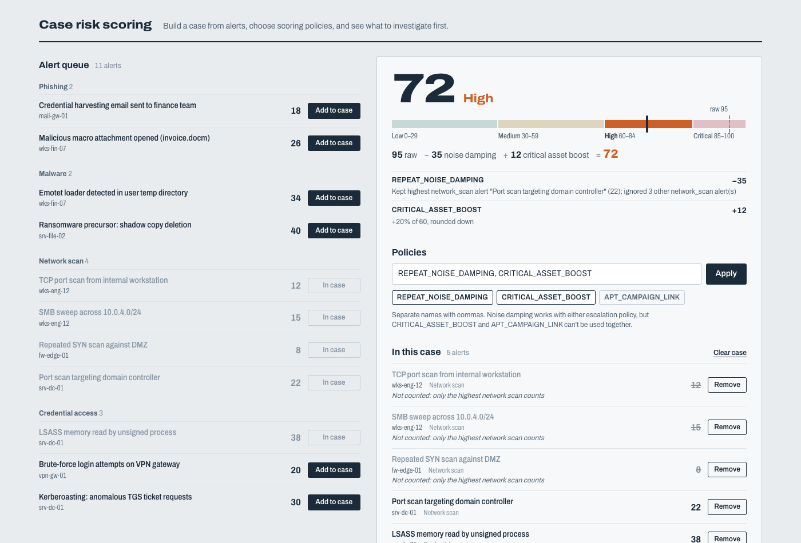

# Incident Case Risk Scoring (assessment started around 10:20 AM and Finished around 11:00)

A small full-stack tool for a SOC analyst. You pick security alerts from a list, group them into a **case**, choose scoring **policies**, and get one risk score with a full breakdown: raw score, each policy adjustment, final score (capped at 100) and a severity band.



## Tech stack

| Layer    | Choice                                    | Why                                                                     |
| -------- | ----------------------------------------- | ----------------------------------------------------------------------- |
| Backend  | Node 22, Express 5, TypeScript            | Small, well known. Express 5 forwards thrown errors to the error handler |
| Database | SQLite via `better-sqlite3`               | Real SQL with constraints and nothing to run alongside the app          |
| Frontend | React 19 + Vite                           | Plain UI with a single component file, no state library                 |
| Tests    | Vitest + Supertest                        | Unit tests for the rules engine, HTTP tests against an in-memory DB     |
| Deploy   | Docker multi-stage image + docker-compose | One container serves the API and the built SPA                          |

## Architecture

```
client/ (React SPA) ──fetch /api/*──▶ server/src/app.ts (Express routes, error mapping)
                                          │
                                          ▼
                                  server/src/repository.ts (SQL: alerts, case, case_alerts)
                                          │ loads alerts + stored policy selection
                                          ▼
                                  server/src/scoring.ts  (pure functions: parsePolicies, scoreCase)
```

- `server/src/scoring.ts` holds the business rules. It has no I/O and no database, which makes it easy to test (`server/test/scoring.test.ts`).
- `server/src/types.ts` defines the domain types. The client imports them as type-only imports, so the API contract is shared.
- `server/src/db.ts` handles schema, migration and seeding. Both run on startup and are idempotent.
- In production, Express serves `client/dist` too, so one process and one port cover everything. In dev, Vite proxies `/api` to Express.

### Data model

```sql
alerts      (id, title, category CHECK IN (...4 categories), source_host, base_score CHECK 1..40)
cases       (id, name, policies TEXT /* JSON array of policy names */, updated_at)
case_alerts (case_id → cases, alert_id → alerts, added_at, PRIMARY KEY (case_id, alert_id))
```

## Business rules and design decisions

### Evaluation order

```
raw score = Σ base_score of alerts in the case
  → 1. REPEAT_NOISE_DAMPING   (if active) drop all network_scan alerts except the highest
  → 2. CRITICAL_ASSET_BOOST   (if active) + min(floor(score × 20%), 30)
     or APT_CAMPAIGN_LINK     (if active) + 25, only if score ≥ 50 at this point
  → 3. cap at 100             final = min(score, 100)
  → 4. severity band          0–29 Low · 30–59 Medium · 60–84 High · 85–100 Critical
```

Why this order:

1. **Damping runs first.** It corrects the input: repeated port scans are noise, and noise should not get amplified. If the boost ran first, 20% of the noise would remain even after damping.
2. **Escalation runs on the damped score.** I read "at least 50 before the boost" as the score immediately before APT_CAMPAIGN_LINK adds its points, which means after damping. A case only reaches 50 by stacking duplicate scans does not count as APT-linked. A test pins this down: raw 55, damped 45, so APT is *not* applied.
3. **The 100 cap is applied once, at the end.** "Final score is capped" puts the cap at the end. Capping earlier would also be *wrong* once damping is involved: raw 150 with 40 points of duplicate scans gives `min(150 − 40, 100) = 100`, but capping first gives `min(150, 100) − 40 = 60`. Capping at the end also keeps `uncappedScore` available, so the UI can show how much was cut off.

### Other decisions

- **The summary is computed, never stored.** The case row stores only the *policy selection*. Every read and every mutation recomputes the summary from the current alerts. This is how the rule "if the case changes and no longer qualifies for an applied policy, the summary must stay correct" is met: there is no stale score to invalidate. If an APT-linked case drops below 50, APT shows up as **not applied**, with the reason. If it grows back above 50, APT applies again automatically. The selection persists because the analyst's judgement ("this is APT-linked") has not changed, only whether the policy qualifies.
- **The two escalation policies cannot both be active.** The API returns `400` and leaves the stored selection unchanged. The rule is checked on write and checked again when a case is read back from the database.
- **Policy input** is free text: comma or whitespace separated, case-insensitive, duplicates removed. Unknown names get a `400` that lists the valid names. An empty input clears all policies.
- **Rounding:** the 20% boost uses integer arithmetic, `Math.floor(score * 20 / 100)`, not `score * 0.2`, so floating-point error cannot turn a whole number into `x.9999…`. The boost is floored *before* the 30-point cap.
- **Damping on ties:** if two network_scan alerts share the top score, exactly one is kept (lowest id wins). The score is the same whichever one is kept.
- **Damping with fewer than 2 scans** shows as "no effect" rather than being hidden, so the analyst can see that it ran.
- **The same alert cannot be added twice** to a case. The `(case_id, alert_id)` primary key enforces this and the API returns `409`.
- **Single case.** The brief describes one case being built up, so the API exposes `/api/case`. The schema already has a `cases` table, so supporting several cases means adding `/api/cases/:id` routes, not changing the schema.

## Running locally

Requires Node 22+ (`better-sqlite3` 13 needs Node 22 or newer).

```bash
npm install
npm run dev          # API on :3000 (tsx watch) + Vite on :5173 with /api proxied
# open http://localhost:5173
```

The SQLite file is created at `data/app.db` on first start. The schema is migrated and alerts are seeded automatically.

Production build, run locally:

```bash
npm run build        # tsc → dist/server, vite → client/dist
npm start            # http://localhost:3000 serves both the UI and the API
```

## Tests

```bash
npm test             # vitest: 38 tests
npm run typecheck    # server + client
```

- `server/test/scoring.test.ts` covers every rule in isolation: severity band edges (29/30, 59/60, 84/85), rounding, the boost cap, the APT threshold at 49 and 50, damping ties, the order of damping vs escalation, the 100 cap, and policy parsing and validation.
- `server/test/api.test.ts` runs HTTP tests against an in-memory SQLite DB: add/remove/duplicate, invalid input, rejected policy combinations not changing state, and the case "stops qualifying, then qualifies again".

## API

All responses are JSON. Errors look like `{ "error": "message" }`.

| Method | Path                       | Body                                         | Returns                                                         |
| ------ | -------------------------- | -------------------------------------------- | --------------------------------------------------------------- |
| GET    | `/api/health`              |                                              | `{ status: "ok" }`                                              |
| GET    | `/api/alerts`              |                                              | `Alert[]`                                                       |
| GET    | `/api/policies`            |                                              | valid policy names                                              |
| GET    | `/api/case`                |                                              | `CaseView` = `{ id, alerts, policies, summary }`                |
| GET    | `/api/case/summary`        |                                              | `ScoreSummary`                                                  |
| POST   | `/api/case/alerts`         | `{ "alertId": 3 }`                           | `201 CaseView` · `404` unknown alert · `409` already in case     |
| DELETE | `/api/case/alerts/:id`     |                                              | `CaseView` · `404` if not in case                                |
| PUT    | `/api/case/policies`       | `{ "policies": "A, B" }` or `["A","B"]`      | `CaseView` · `400` unknown or conflicting policies               |
| DELETE | `/api/case`                |                                              | `CaseView`: removes all alerts and clears policies               |

Every mutation returns the full, freshly scored `CaseView`, so the client never computes scores itself.

Example `summary`:

```json
{
  "rawScore": 95,
  "adjustments": [
    { "policy": "REPEAT_NOISE_DAMPING", "applied": true, "points": -35, "scoreBefore": 95, "scoreAfter": 60,
      "reason": "Kept highest network_scan alert \"Port scan targeting domain controller\" (22); ignored 3 other network_scan alert(s)" },
    { "policy": "CRITICAL_ASSET_BOOST", "applied": true, "points": 12, "scoreBefore": 60, "scoreAfter": 72,
      "reason": "+20% of 60, rounded down" }
  ],
  "uncappedScore": 72,
  "finalScore": 72,
  "capped": false,
  "severity": "High",
  "ignoredAlertIds": [5, 6, 7]
}
```

## Deployment

### Docker Compose (recommended)

```bash
docker compose up -d --build
# open http://localhost:3000   (set HOST_PORT=8080 to change the host port)
```

The SQLite database lives on the named volume `case-data`, mounted at `/data`, so the case survives restarts and redeploys.

### Plain Docker

```bash
docker build -t case-risk-scoring .
docker run -d -p 3000:3000 -v case-data:/data --name case-risk-scoring case-risk-scoring
```

### Environment variables

| Variable        | Default                    | Purpose                                     |
| --------------- | -------------------------- | ------------------------------------------- |
| `PORT`          | `3000`                     | HTTP port                                   |
| `DATABASE_PATH` | `data/app.db` (`/data/app.db` in Docker) | SQLite file location; the directory is created if missing |
| `STATIC_DIR`    | `<repo>/client/dist`       | Built SPA to serve; skipped if the directory is missing |

No secrets are needed.

### Migrating and seeding the database

- **Automatic:** on every start, the server runs `CREATE TABLE IF NOT EXISTS …`, creates the default case, and seeds the 11 alerts if the `alerts` table is empty.
- **Manual re-seed:** upserts the seed alerts by id and leaves the case alone.
  - Local: `npm run db:seed`
  - Docker: `docker compose exec app node dist/server/seed.js`
- **Re-seed and empty the case:** add `--reset`, e.g. `docker compose exec app node dist/server/seed.js --reset`.

### Hosting platform (e.g. Render, Fly.io, Railway)

1. Create a service from this repo using the `Dockerfile`.
2. Attach a persistent disk/volume mounted at `/data` (SQLite needs local disk that survives restarts).
3. Set `DATABASE_PATH=/data/app.db`. Most platforms inject `PORT`, and the app reads it.
4. Health check path: `/api/health`.
5. Run a single instance. SQLite is a local file, so the app cannot scale horizontally (see limitations).

## Known limitations

- **Single case and a single SQLite file**: no multi-user support, no concurrent analysts, no horizontal scaling. For that I would move to Postgres and add `/api/cases/:id`.
- **No authentication or authorization**, as the brief allows. Anyone who can reach the port can change the case.
- **Alerts are static seed data.** There is no ingestion API.
- **Two analysts editing at once**: the last write wins, and there is no optimistic locking or live update between browser tabs.
- **No audit trail** of who changed policies or when (only `updated_at`).

## What I would improve with more time

- Multiple cases, with a case list and per-case URLs.
- An audit log of policy changes, plus a persisted score history so trends are visible.
- Policy configuration (percentages, caps, thresholds) loaded from data rather than constants, with versioning, so a score can be reproduced later.
- Frontend tests (React Testing Library) and a Playwright end-to-end test.
- CI (GitHub Actions) running typecheck, tests and the Docker build.
- Structured logging and request IDs.
- A UI control for policies (checkboxes with the escalation pair as radio buttons) next to the free-text box, so invalid combinations cannot be entered at all.

## Security and domain assumptions

- **Domain:** `base_score` is assumed to already be normalised by the detection source (1–40). Noise damping only applies to `network_scan`, as specified. Other repeated categories (e.g. 5× brute force) still count in full, because repetition there can mean real escalation. CRITICAL_ASSET_BOOST and APT_CAMPAIGN_LINK are analyst assertions about the case. The tool does not verify them, for example by checking an asset inventory or threat-intel feed.
- **Input validation:** all ids are checked to be positive integers, policies are whitelisted, and JSON bodies are limited to 10 kB. Every SQL statement is parameterised, and the only interpolated SQL is a constant list of categories. The database adds CHECK constraints so invalid data is caught even outside the API.
- **XSS:** React escapes every rendered value, and no HTML is injected.
- **Error responses** never include stack traces. Unexpected errors are logged on the server and the client gets a generic `500`.
- **Container** runs as the non-root `node` user, with build tools only in the build stage.
- **No auth** is an accepted assumption of the exercise. In a real deployment this would sit behind SSO, and policy changes would be attributed to an analyst.

## Submission notes

See [SUBMISSION.md](SUBMISSION.md) for the prompts used, build time, token usage, and the places where the AI needed correcting.
